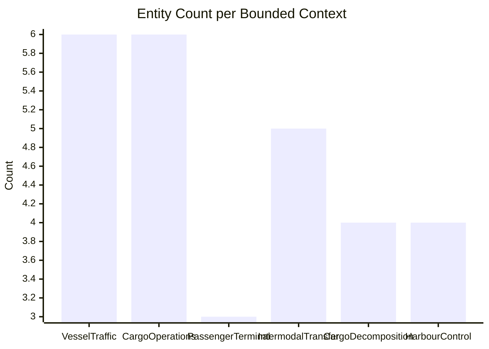

# Domain Complexity Heatmap

> Auto-generated by muscomp. Do not edit manually.

| Context | Entities | Aggregates | Events | Complexity |
|---------|----------|------------|--------|------------|
| VesselTraffic | 6 | 1 | 5 | 13 |
| CargoOperations | 6 | 2 | 0 | 8 |
| PassengerTerminal | 3 | 1 | 3 | 9 |
| IntermodalTransfer | 5 | 1 | 5 | 12 |
| CargoDecomposition | 4 | 2 | 3 | 9 |
| HarbourControl | 4 | 0 | 2 | 6 |
